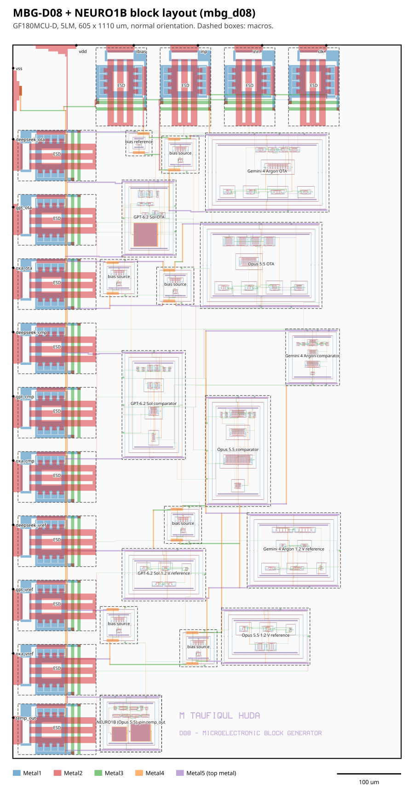

# Microelectronic Block Generator

MBG provides Basic and Intermediate tools for analog circuit layout with gLayout
and gdsfactory. Work from an explicit SPICE input: inspect devices and nets,
simulate, generate a checked layout, inspect placement/routing, export ordinary
macro views, and run DRC, LVS and parasitic extraction.

See [public feature levels](docs/features.md) for the supported scope and
[validation](docs/validation.md) for checks executed on this release.

## Chipathon 2026 submission

The existing MBG-D08 submission is preserved in [mbg-toplevel](mbg-toplevel/),
with its [pin map](info.yaml) and [LVS configuration](lvs_config.json).
These are previously published submission artifacts; their presence does not
expand the generator's supported feature levels. Preserve them during tool
updates and repository cleanup.



*MBG-D08 + NEURO1B block layout (`mbg-toplevel/layout/mbg_d08.gds`, 605 x 1110 um, GF180MCU-D).
The author name is drawn on the top metal at the lower right. DRC (Magic and KLayout) is clean and LVS matches;
see [the report](mbg-toplevel/mbg-d08_report.md).*

## Install

Use Python 3.11 for the supplied dependency lock. No PDK or EDA binary is bundled.

```bash
./install.sh --list
./install.sh --stage python
./install.sh --check
```

Installation downloads dependencies only when explicitly requested. Read
[installation](docs/install.md) for pinned PDK/tool setup and offline checks.
EDA helper scripts are maintained under `scripts/eda`; setup wrappers are under
`scripts/setup`. Keep the PDK license and upstream tool licenses intact.

## Tool interface

```bash
scripts/mbg doctor
scripts/mbg tools
scripts/mbg pdk info --pdk gf180mcuD
scripts/mbg netlist check --netlist circuit.spice
scripts/mbg layout generate --netlist circuit.spice
```

Use `scripts/mbg tools <tool.id>` for exact arguments supported by this release.
Default generated files use `~/mbg`; `MBG_OUT` selects another output root.
Explicit destinations remain authoritative. Preserve input circuits and results.

Every call reports a JSON result with status, metrics, artifacts and issues.
A generated GDS is not sign-off: DRC, LVS, extraction, extracted simulation and
specifications each require their own evidence. Missing checks stay NOT RUN or
NOT AVAILABLE. Ordinary macro views do not imply an executed integration flow.

## Agents and MCP

The same public registry serves CLI and MCP clients. [Agent instructions](AGENTS.md)
apply to every harness. Canonical skills and workflows live under `.ai/` and are
generated for OpenCode, Claude Code, Codex and the Agent Skills standard tree.
Project MCP configurations are supplied for Claude Code, Codex, Cursor and Gemini;
OpenCode uses `opencode.jsonc`. Other clients can launch `scripts/mbg mcp` on stdio.

```bash
python3 scripts/sync_agent_tools.py
python3 scripts/sync_agent_tools.py --check
python3 scripts/validate_agent_integrations.py
```

See [the agent interface](docs/agent-interface.md) and generated [tool schemas](docs/TOOLS.md).

## Confidentiality and contributions

Unreleased user inputs and artifacts are confidential. Explicit user permission
is required before publishing them or pushing changes. Do not add credentials,
signed forms, local logs, personal paths or unreleased designs to this repository.
Use the existing human Git identity. The existing [license](LICENSE) applies.
