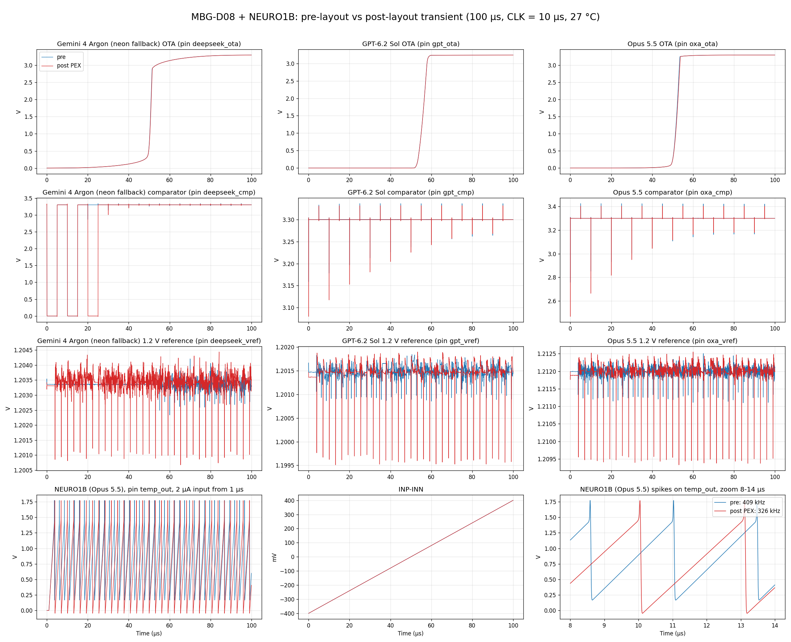
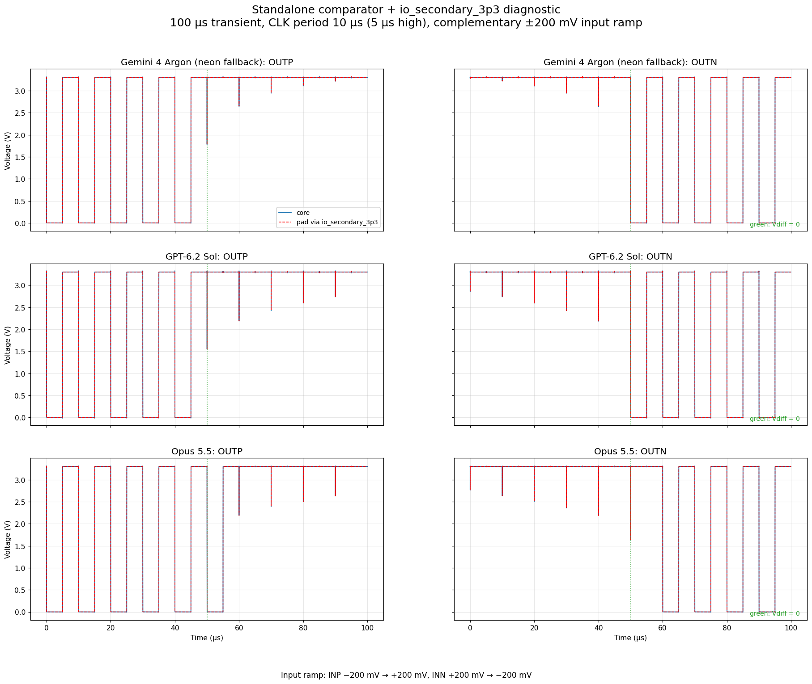

# MBG-D08 + NEURO1B: pre/post-layout verification report

Date: 2026-11-23  
Layout: `layout/mbg_d08.gds` (single top cell `mbg_d08`, 605 x 1110 um)  
GDS sha256: `de202cd8d79c6b45fcd94ee88524b32538ff66ce3a8da0da91988ba6b6ffbcb1`  
Technology: GF180MCU-D, 5LM, MIM option B, 3.3 V devices

This report replaces the earlier report for the previous layout (relaxation-oscillator temperature sensor on `temp_out`). `temp_out` is now the NEURO1B spiking temperature sensor, designed with Opus 5.5.

## Models and names

| Model | Block identifier | Top-level pins (committee-fixed) |
|---|---|---|
| GPT-6.2 Sol | `gpt62sol_vref`, `gpt62sol_ota`, `gpt62sol_cmp` | `gpt_vref`, `gpt_ota`, `gpt_cmp` |
| Opus 5.5 | `opus55_vref`, `opus55_ota`, `opus55_cmp`, NEURO1B | `oxa_vref`, `oxa_ota`, `oxa_cmp`, `temp_out` |
| Gemini 4 Argon (neon fallback) | `gemini4argon_vref`, `gemini4argon_ota`, `gemini4argon_cmp` | `deepseek_vref`, `deepseek_ota`, `deepseek_cmp` |

Block, instance and net names inside the layout, netlists and DEF use the identifiers. The 16 pin names are fixed by the committee `D08_BV.def` and pad map and keep the old prefixes, so renaming the models changed no pin and no geometry.

## Decisions applied

- Orientation: **normal**, matching the committee `def/D08_BV.def`. The floorplanner lists D08 as mirrored; flagged for the organizers.
- PR boundary: follows the committee `D08_BV.def` `DIEAREA` = 605 x 1110 um (layer 0/0, top level).
- Top cell name equals the GDS file name: `mbg_d08`.
- `temp_out` / W12: NEURO1B (designed with Opus 5.5) replaces the earlier relaxation-oscillator temperature sensor on this pin; it is not an overlay. The pin name `temp_out` is kept by team decision, so the pad map and `D08_BV.def` are unchanged. NEURO1B is a spiking neuron: its single pad takes an input current and shows the spikes on the same pin, so a testbench must drive `temp_out` (about 2 uA gives roughly 300-400 kHz).
- Author name: `M Taufiqul Huda` and `D08 - Microelectronic Block Generator` are drawn as polygons on the top metal (Metal5, layer 81/0) in the empty region x 260-481 um, y 36-72 um (47 shapes, generated with the KLayout text generator; clean against the Metal5 width, spacing and area rules). They replace the earlier text records on layer 0/0. The artwork is floating metal, with no electrical connection.
- Manual layout edits (from the D08 team's `eda/designs/mbg_d08.gds`): the ESD-to-pad connections were widened by hand (Metal2 +5194 um2, plus Metal1, Metal3, Metal4 and Via1-Via3 changes near the pins). Two orphan Via2 + Metal3 stubs left by that edit, at (169.1, 1102.1) um and (369.0, 1102.1) um, broke rule M3.3 (Metal3 minimum area) and were removed. `def/mbg-d08-routed.def` is the router output and does not include these manual edits.
## Result summary

| Check | Result |
|---|---|
| Magic DRC | **PASS**, 0 violations |
| KLayout DRC (variant D, 5LM, MIM B deck) | **PASS**, 0 violations |
| netgen LVS vs `mbg-d08_lvs.spice` | **PASS**, circuits match uniquely |
| Coupled PEX (Magic, mode 2) | **PASS**, 405 C, 0 R raw (`post_sim/mbg-d08.pex.raw.spice`); 318 C in the simulation netlist `post_sim/mbg-d08.pex.spice`, which leaves out the 87 capacitors of the floating name artwork (finding 6) |
| Full-RC PEX (mode 3) | **FAIL**, Magic stops after its start message (open) |
| Landing connectivity vs committee `D08_BV.def` | **PASS**, 124 rectangles in 16 clusters |
| Pin names / order vs committee pad map | **PASS**, 16/16 |
| Simulation vs the previous layout (before the manual widening) | pre-layout **identical**; post-layout: 31 of 2048 values changed by at most 3 %, no pass/fail changed |
| Pre-layout simulation (harness, 45 PVT where run) | **PASS** for references and OTAs; comparators see finding 1 |
| Post-layout simulation (capacitance-only extraction) | **PASS** for references and OTAs; comparators see finding 1 |
| Integrated NEURO1B transient (2 uA step, top-level bench) | **PARTIAL**: spikes at 408.7 kHz pre-layout and 325.9 kHz post-layout, inside the standalone 45-PVT range (310.9-423.5 / 269.4-367.5 kHz); it couples ripple into the references (finding 3); `ibias` loading not isolated |
| Metal / poly density (die-level fill) | **PARTIAL**, not run |

Set aside by the D08 team (2026-11-23): full-RC PEX is not pursued; power pad cells and density fill are handled by the Chipathon committee; post-layout results are scored by the committee testbench. `verification/readiness.md` lists them as waived, not as passed.

Evidence files: `verification/` (DRC, LVS, PEX records, landing audit, readiness). Readiness is **NOT READY** until the open items below are closed.

## Top-level DC

| Stage | Supply current | gpt_vref | oxa_vref | deepseek_vref |
|---|---|---|---|---|
| pre-layout | 0.6966 mA | 1.20149 V | 1.212 V | 1.20336 V |
| post-layout | 0.6943 mA | 1.20149 V | 1.212 V | 1.20343 V |

At DC this is identical to the baseline D08 (`outputs/d08-route-all`, same harness): NEURO1B idle does not move the references or the supply current. The harness numbers below are with NEURO1B idle; with NEURO1B spiking see the transient plot and finding 3.

## Simulation plots

### Top-level transient, pre-layout vs post-layout



100 us transient at 27 C, CLK = 10 us, complementary linear ramp on INP/INN (INP-INN from -400 mV to +400 mV), 20 uA on `ibias`, and a 2 uA current step into `temp_out` at 1 us that makes NEURO1B spike (same stimulus as its standalone bench). Blue = pre-layout schematic (`mbg-d08_pre_tb.spice`), red = post-layout with extracted capacitance (`mbg-d08_post_tb.spice`). Panels are titled with the model, the block and the committee-fixed pin name; the last panel zooms into the NEURO1B spikes. Regenerate with `make_plots.py`.

| Output (pin) | Block | Pre-layout at 100 us (V) | Post-layout at 100 us (V) | Post - pre (V) |
|---|---|---|---|---|
| `deepseek_ota` | Gemini 4 Argon OTA | 3.2992 | 3.2991 | -0.000124 |
| `gpt_ota` | GPT-6.2 Sol OTA | 3.2386 | 3.2387 | +3.24e-05 |
| `oxa_ota` | Opus 5.5 OTA | 3.3 | 3.3 | +1.32e-05 |
| `deepseek_cmp` | Gemini 4 Argon comparator | 3.3 | 3.3 | +1.66e-06 |
| `gpt_cmp` | GPT-6.2 Sol comparator | 3.3 | 3.3 | +5e-08 |
| `oxa_cmp` | Opus 5.5 comparator | 3.3 | 3.3 | -1.21e-06 |
| `deepseek_vref` | Gemini 4 Argon 1.2 V reference | 1.2033 | 1.2035 | +0.000206 |
| `gpt_vref` | GPT-6.2 Sol 1.2 V reference | 1.2014 | 1.2015 | +3.32e-05 |
| `oxa_vref` | Opus 5.5 1.2 V reference | 1.2121 | 1.212 | -0.000122 |

Reading the plot: the OTAs and comparators are unaffected by NEURO1B (the OTA outputs sit at their rails and only the Gemini 4 Argon comparator toggles on the ramp; the other two show decision spikes without a full swing, finding 1). The three references show downward spikes in step with NEURO1B (finding 3).

### NEURO1B inside the integrated chip (2 uA step into `temp_out`)

| Stage | Spike rate on `temp_out` | Standalone 45-PVT range at 2 uA | `temp_out` min / max (V) | Rate with NEURO1B off |
|---|---|---|---|---|
| pre-layout | 408.7 kHz (37 spikes after 8 us) | 310.9-423.5 kHz | 0.000 / 1.773 | 0 kHz |
| post-layout | 325.9 kHz (30 spikes after 8 us) | 269.4-367.5 kHz | -0.046 / 1.770 | 0 kHz |

Reference ripple at t >= 8 us (peak-to-peak, mV; control = same bench with NEURO1B off):

| Reference (pin) | Pre-layout, NEURO1B off | Pre-layout, NEURO1B spiking | Post-layout, NEURO1B off | Post-layout, NEURO1B spiking |
|---|---|---|---|---|
| GPT-6.2 Sol (`gpt_vref`) | 0.063 | 0.988 | 0.025 | 2.388 |
| Opus 5.5 (`oxa_vref`) | 0.728 | 1.407 | 0.037 | 3.222 |
| Gemini 4 Argon (neon fallback) (`deepseek_vref`) | 0.029 | 1.872 | 0.034 | 3.766 |


### Comparator diagnostic with the io_secondary_3p3 pad



Standalone comparator through the `io_secondary_3p3` ESD cell (`cmp_debug/`): the pad waveform (red, dashed) follows the core node (blue) for all three models, so the ESD cell does not change the comparator behavior in this bench.

## Benchmark per AI model

Pre = schematic top level; Post = capacitance-only extraction of `layout/mbg_d08.gds`; Baseline post = previous D08 layout without NEURO1B. Harness: `run_submission_sim.py` (kept in the MBG working repository under `submission-prep/sim/`, not part of this tree; ngspice, typical models; PVT = 5 process x 3 VDD x 3 temperature).

### GPT-6.2 Sol

Blocks `gpt62sol_vref`, `gpt62sol_ota`, `gpt62sol_cmp` (pins `gpt_vref`, `gpt_ota`, `gpt_cmp`).

| Metric | Pre-layout | Post-layout | Baseline post |
|---|---|---|---|
| vref nominal_V | 1.20149 | 1.20149 | 1.20149 |
| vref tc_ppm_C | 52.37 | 52.37 | 52.37 |
| vref line_reg_mV_V | 11.7 | 11.7 | 11.7 |
| vref pvt_ok | 45 | 45 | 45 |
| ota dc_gain_dB | 70.75 | 70.74 | 70.74 |
| ota gbw_MHz | 2.186 | 2.173 | 2.173 |
| ota pm_deg | 68.92 | 68.17 | 68.18 |
| ota sr_fall_V_us | 6.11 | 6.116 | 6.197 |
| ota pvt_ac_pass | 45/45 | 45/45 | 45/45 |
| cmp nom_5mV_delay_pos_ns | 0.152 | 0.294 | 0.295 |
| cmp nom_5mV_pass | False | False | False |
| cmp pvt_pass | 45/90 | 45/90 | 45/90 |

### Opus 5.5

Blocks `opus55_vref`, `opus55_ota`, `opus55_cmp` (pins `oxa_vref`, `oxa_ota`, `oxa_cmp`).

| Metric | Pre-layout | Post-layout | Baseline post |
|---|---|---|---|
| vref nominal_V | 1.212 | 1.212 | 1.212 |
| vref tc_ppm_C | 35.15 | 35.14 | 35.14 |
| vref line_reg_mV_V | 9.64 | 9.64 | 9.64 |
| vref pvt_ok | 45 | 45 | 45 |
| ota dc_gain_dB | 48.75 | 48.71 | 48.71 |
| ota gbw_MHz | 2.799 | 2.677 | 2.678 |
| ota pm_deg | 84.48 | 83.85 | 83.85 |
| ota sr_fall_V_us | 1.577 | 1.441 | 1.442 |
| ota pvt_ac_pass | 45/45 | 45/45 | 45/45 |
| cmp nom_5mV_delay_pos_ns | 0.205 | 0.349 | 0.349 |
| cmp nom_5mV_pass | False | False | False |
| cmp pvt_pass | 45/90 | 45/90 | 45/90 |

#### NEURO1B (spiking temperature sensor on `temp_out`, designed with Opus 5.5; standalone, 45 PVT)

| Metric | Pre-layout | Post-layout |
|---|---|---|
| linearity_typ_pct | 1.14847 | 1.18408 |
| linearity_pvt_pct | 1.79397 | 1.81853 |
| rate_2uA_min_hz | 310852 | 269390 |
| rate_2uA_max_hz | 423480 | 367511 |
| silent_spikes_max | 0 | 0 |
| monotonic_violations | 0 | 0 |

Standalone numbers from `projects/ai_neuro1/results/`. Inside the integrated chip (2 uA step on `temp_out`) it spikes at 408.7 kHz pre-layout and 325.9 kHz post-layout; see the NEURO1B section under Simulation plots.

### Gemini 4 Argon (neon fallback)

Blocks `gemini4argon_vref`, `gemini4argon_ota`, `gemini4argon_cmp` (pins `deepseek_vref`, `deepseek_ota`, `deepseek_cmp`).

| Metric | Pre-layout | Post-layout | Baseline post |
|---|---|---|---|
| vref nominal_V | 1.20336 | 1.20343 | 1.20343 |
| vref tc_ppm_C | 20.72 | 20.43 | 20.43 |
| vref line_reg_mV_V | 8.58 | 8.71 | 8.71 |
| vref pvt_ok | 45 | 45 | 45 |
| ota dc_gain_dB | 51.0 | 50.74 | 50.74 |
| ota gbw_MHz | 13.882 | 12.857 | 12.865 |
| ota pm_deg | 81.1 | 79.22 | 79.22 |
| ota sr_fall_V_us | 14.658 | 12.671 | 12.672 |
| ota pvt_ac_pass | 45/45 | 45/45 | 45/45 |
| cmp nom_5mV_delay_pos_ns | 0.781 | 1.858 | 1.859 |
| cmp nom_5mV_pass | False | False | False |
| cmp pvt_pass | 45/90 | 45/90 | 45/90 |

## Findings

1. **Comparators fail the nominal -5 mV check** in the baseline and in this layout (pre-existing, not caused by NEURO1B). In the 100 us ramp bench only the Gemini 4 Argon comparator (`deepseek_cmp`) toggles on the complementary ramp; the GPT-6.2 Sol and Opus 5.5 comparators show decision spikes without a full output swing. The OUTP pin drives an ESD cell while OUTN is internal.
2. **Full-RC PEX fails because Magic crashes.** Magic 8.3.681 segfaults (exit 139) in its resistance extractor (`extresist`). The capacitance extraction works (modes 1 and 2). Isolating it cell by cell: `extresist` completes on every macro alone (references, OTAs, comparators, NEURO1B, bias cells) and on a plain metal rectangle, and crashes only on the `d08_esd` ESD cell, which the chip instantiates 14 times. Flat, hierarchical, `simplify off`, `lumped on` and `blackbox on` all crash. `extresist ignore to_gate` avoids the crash, but the result is 143 MB with 1.88 million resistors (dominated by the supply and top-metal meshes) covering only 193 of 628 nets, too large to simulate as is. The distro Magic cannot load the gf180mcuD tech, so it was not a usable comparison. The geometry in `d08_esd` that triggers the crash is not identified. Only coupled-capacitance results are available.
3. **NEURO1B couples into the references while it spikes.** With a 2 uA input on `temp_out`, NEURO1B fires at 409 kHz (pre-layout) and 326 kHz (post-layout), inside its standalone range, and all three references show downward spikes in step with it. Reference ripple (peak-to-peak) rises from 0.02-0.04 mV with NEURO1B off to 2.4-3.8 mV post-layout (1.0-1.9 mV pre-layout), i.e. about 0.1-0.3 % of 1.2 V, and the extracted parasitics make it worse. The earlier statement that NEURO1B does not disturb the references holds only at DC. The coupling path (shared `vdd`, the shared `ibias` net `ibias_core`) and the effect on the OTA and comparator specs were not isolated; the OTA and comparator panels in this bench are unaffected.
4. **Committee items**: orientation (the planner lists D08 as mirrored; the committee `D08_BV.def` is normal and is followed) and double ESD (block `io_secondary_3p3` plus pad `asig_5p0`). Power pad cells, density fill and the wafer.space frame confirmation are handled by the committee; the D08 team is responsible for the block area only.
5. **KLayout LVS (`lvs_run/`) was not re-run** for this layout: the previous `.lvsdb` and extracted netlist described the old design and were removed from this folder. Sign-off LVS here is netgen.

6. **Simulating the name artwork needs care.** The name is floating Metal5, so Magic extracts it as 47 nodes connected only through 87 capacitors (41 fF of 2014 fF). With those nodes in the netlist, ngspice reports a singular matrix and converges to non-physical points (wrong OTA outputs; 250 mA supply current at 5 of 45 PVT corners), even with `rshunt=1e12`. The simulation netlist therefore omits those capacitors (`sim/make_sim_netlist.py`); the raw extraction is kept in `post_sim/mbg-d08.pex.raw.spice`. With the artwork omitted, all gates are unchanged from the previous layout.
## Files

- `layout/mbg_d08.gds`, `layout/gds.sha256`
- `def/D08_BV.def` (committee), `def/mbg-d08-routed.def`
- `mbg-d08.spice`, `mbg-d08_pre_sim.spice`, `mbg-d08_lvs.spice`; block netlists in `spice/` (`gpt62sol_*`, `opus55_*`, `gemini4argon_*`, `neuro1b.spice`; the `*_oscillator` and `opus55_temp_sensor` netlists are the earlier sensor designs, kept for reference and not part of the current design)
- `mbg-d08_pre_tb.spice`, `mbg-d08_post_tb.spice`, `make_plots.py`, `mbg-d08_simulation_plot.png`; comparator diagnostics in `cmp_debug/` (`*_cmp_io_tb.spice`, `.dat`, plot)
- `post_sim/mbg-d08.pex.spice` (simulation netlist), `post_sim/mbg-d08.pex.raw.spice` (full extraction incl. name artwork), `post_sim/pex_mbg_d08.tcl`, `post_sim/mbg_d08_coupled.ext`
- `floorplan/` (pin positions, frame record), `verification/` (records and readiness)

## Reproduce

```
scripts/mbg verify drc --gds mbg-toplevel/layout/mbg_d08.gds --cell mbg_d08
scripts/mbg verify lvs --gds mbg-toplevel/layout/mbg_d08.gds --netlist mbg-toplevel/mbg-d08_lvs.spice --cell mbg_d08
scripts/mbg verify pex --gds mbg-toplevel/layout/mbg_d08.gds --cell mbg_d08 --mode 2
```

The testbenches `mbg-d08_pre_tb.spice` / `mbg-d08_post_tb.spice` use the container PDK path of the original submission; edit the `.lib`/`.include` paths to your PDK location before running them with `ngspice -b`, then `python3 make_plots.py`.
