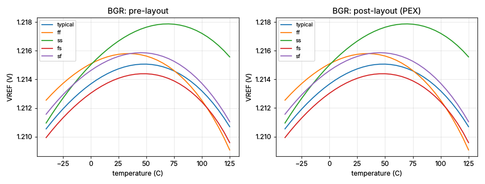

# 1.2 V bandgap voltage reference — `vref_bgr_1v2` (gf180mcuD)

**Status: PASS against the `prompt-test/VREF.md` gate, pre-layout and
post-layout (PEX). Stretch targets: 4 of 6 met (line regulation and PSRR are
not).** Layout: all four sign-off legs pass — Magic DRC clean, KLayout
foundry deck (variant D) clean, netgen LVS match, internal connectivity
clean; PEX extracted and re-simulated.

> This variant **deliberately breaks VREF.md's "MOS-only, no BJT, no
> resistor" clause**: it is the bandgap side of a two-topology comparison
> requested for this experiment. Ports and gate specifications are VREF.md's,
> so it is a drop-in alternative to the MOS-only designs.

Produced by an AI agent (Claude Code) driving MBG **only through
`scripts/mbg`**. It is the first MBG layout with vertical PNPs and
high-resistance poly resistors, and is above the previously tested complexity
ceiling (19 devices, 14 nets, VSS net degree 21 vs 12 MOS / 11 nets / 16).

| | |
|---|---|
| Ports | `VDD VSS VREF IBIAS` |
| Devices | 10 MOS, 4 vertical PNP (`pnp_05p00x05p00` x2, `pnp_10p00x10p00` x2), 5 `ppolyf_u_1k` |
| Layout | 81.3 x 80.5 µm = 6541 µm² |
| Supply current | 24.7 µA (worst corner; 19.7 µA typical) |

## Topology

```
          XM1        XM2        XM3          (PMOS mirror, gates = PG)
           │ VA       │ VB       │ VREF
          Q1 (1x)    R1         R2 = 4 x 25 µm units
                      │ VX       │ VC
                     Q2 (8x)    Q3 (1x)

  OTA: + = VB, − = VA  ──► PG      (PMOS input pair, NMOS mirror load,
                                     tail XM4 biased from PG)
  startup: IBIAS ──► node IBIAS ── XM9 (gate VREF) to VSS
                                  └ XM10 (gate IBIAS) pulls PG low
```

VREF = VBE(Q3) + (R2/R1)·VT·ln N with N = 8: Q1 is one 5x5 µm PNP, Q2 two
10x10 µm PNPs in parallel (8x the emitter area). The OTA forces VA = VB, so the
current in R1 is ΔVBE/R1 (PTAT); XM1–XM3 copy it to all branches.

Design decisions the agent made, each from a simulation:

* **PMOS-input OTA** — its inputs sit at VBE ≈ 0.70 V, too low for an NMOS pair.
* **Long core PMOS (L = 8 µm)** — the first candidate did not regulate: PG must
  sit below the OTA's tail node, and with L = 2 µm the mirror needed PG ≈ 2.3 V
  (found by probing internal nets with `mbg sim run --probes PG NT VA VB`).
* **R2 at the curvature minimum** — swept R2's unit length 21–26 µm; TC is
  lowest at 25 µm (22.5 ppm/°C typical).
* **IBIAS drives the startup**, so the pin keeps its role in the common
  interface. While VREF is low the IBIAS current pulls the IBIAS node up and
  XM10 pulls PG down; once VREF is up XM9 sinks IBIAS and XM10 is off. The
  measurement recipe caught a weak first sizing (XM9 W = 2 µm let XM10 turn
  back on at ss/sf with 30 µA, shifting VREF by 80 mV); with W = 8 µm VREF moves
  0.01 mV over IBIAS 5–40 µA at every corner.
* **R1 interdigitated in the R2 string** with a placement hint
  (`final/placement_hints.json`: row order R2a R2b R1 R2c R2d), a resistor-ratio
  matching choice the automatic placer had not made.

## Results (5 corners; −40…125 °C; VDD 3.0…3.6 V; bjt/res corners follow the MOS corner)

| Metric | Gate (VREF.md) | Stretch | Pre-layout | Post-layout (PEX) |
|---|---|---|---|---|
| VREF @ 27 °C, typical | 1.15–1.25 V | 1.2 V ±2 % | **1.2148 V** | **1.2148 V** |
| TC, worst corner (box) | ≤ 300 ppm/°C | ≤ 50 | **34.5** (typ 22.5) | **34.5** (typ 22.5) |
| Line regulation 3.0–3.6 V | ≤ 100 mV/V | ≤ 5 | **20.7** | **20.7** |
| ΔVREF over 3.0–3.6 V | ≤ 60 mV | — | 12.4 mV | 12.4 mV |
| IVDD (excl. IBIAS) | ≤ 300 µA | — | 24.7 µA | 24.7 µA |
| PSRR @ 10 Hz | — | ≤ −40 dB | −34.0 dB | −34.0 dB |
| Startup (VDD ramp 10 µs) | — | ≤ 100 µs | 8.4 µs | 8.2 µs |
| IBIAS sensitivity 5–40 µA | characterise | — | 0.01 mV | 0.00 mV |

Per corner (post-layout): VREF 1.2148 / 1.2158 / 1.2168 / 1.2141 / 1.2157 V
(typical / ff / ss / fs / sf) — a 2.7 mV process spread, against 281 mV for the
MOS-only design. TC 22.5 / 33.6 / 34.5 / 24.0 / 24.0 ppm/°C.

Line regulation and PSRR miss the stretch targets for the same reason: the
OTA's output (PG) follows VDD one-for-one, its finite gain turns that into an
input offset, and the bandgap multiplies the offset by about (1 + R2/R1).
Raising the OTA's L brought line regulation from 33 to 21 mV/V; a cascoded or
two-stage OTA is the next step and was left out to stay near the tested
complexity.



### A post-layout bug this experiment found and fixed

The first post-layout run disagreed with the schematic (VREF 1.2205 V, a
stepped temperature curve). Cause: Magic's PEX netlist uses `.option scale=5n`,
which ngspice applies to MOSFET geometry but **not** to subcircuit parameters,
so every `ppolyf_u*`/MIM instance was simulated with `r_width=200
r_length=5000` read as metres. `checks.run_pex` now converts those parameters
to µm (`rescale_subckt_passives`); the post-layout numbers above are from the
corrected extraction and match the schematic. Earlier post-layout results of
designs with poly resistors or MIM capacitors were affected.

## Design log (16 candidates, bounded at 16)

| # | Change | Result |
|---|---|---|
| 1 | first netlist, core PMOS L = 2 µm | no regulation: VREF 1.48 V, 1120 mV/V (PG out of OTA range) |
| 2 | core PMOS L = 8 µm | regulates: 1.204 V, 79 ppm/°C, 33 mV/V |
| 3–5 | OTA input L 2/4 µm, load L 8/16 µm | 4/8 kept: 56 ppm/°C, 17.5 mV/V |
| 6–10 | R2 unit 21/22/23/25/26 µm | TC minimum at 25 µm: 22.6 ppm/°C typical |
| 11–13 | R2 unit 24.5/25/25.5 µm, all corners | 25 µm: worst 34.6 ppm/°C, VREF 1.2148 V |
| 14–16 | startup XM9/XM10 sizing | XM9 8/1, XM10 1/2: IBIAS sensitivity 0.01 mV |

## Reproduce

```bash
scripts/mbg design init vref-bgr-1v2 --pdk gf180mcuD --netlist results/claude-code_vref_1v2_bgr/generated_netlist.spice
scripts/mbg measure vref --design vref-bgr-1v2 --spec vref_md --corners all --ibias-sweep 5u 10u 20u 30u 40u
scripts/mbg layout generate --design vref-bgr-1v2 --hints results/claude-code_vref_1v2_bgr/final/placement_hints.json
scripts/mbg measure vref outputs/vref-bgr-1v2/layout/vref_bgr_1v2.pex.spice --post-layout --spec vref_md --corners all
```

## Files

As in `../claude-code_vref_1v2_cmos/REPORT.md`, plus
`final/placement_hints.json`.
