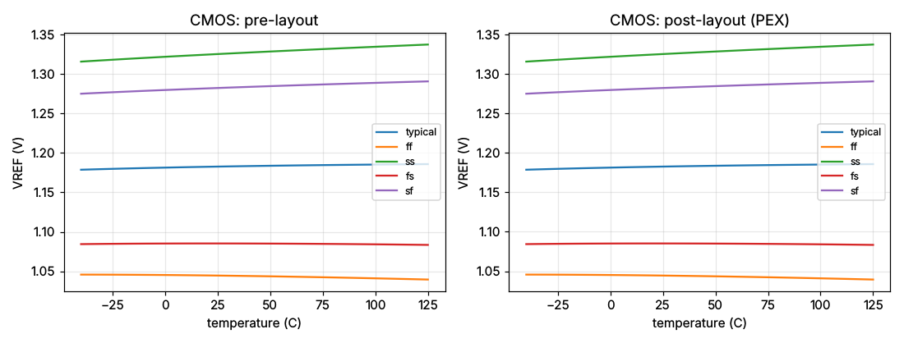

# 1.2 V MOS-only voltage reference — `vref_cmos_1v2` (gf180mcuD)

**Status: PASS against the `prompt-test/VREF.md` gate, pre-layout and
post-layout (PEX). Stretch targets: 5 of 6 met (TC is not).**
Layout: all four sign-off legs pass — Magic DRC clean, KLayout foundry deck
(variant D) clean, netgen LVS match, internal connectivity clean; PEX
extracted and re-simulated.

This design was produced by an AI agent (Claude Code) **driving MBG only
through the `scripts/mbg` command line** — no hand-written Python driver
scripts. Every number below comes from an `mbg measure vref` or
`mbg layout generate` envelope stored in this directory.

| | |
|---|---|
| Ports | `VDD VSS VREF IBIAS` (as VREF.md; IBIAS = 20 µA pushed into the pin) |
| Devices | 5 MOS (`nfet_03v3` x3, `pfet_03v3` x2) |
| Layout | 44.6 x 22.2 µm = 989 µm² |
| Supply current | 40.6 µA (worst corner, excluding IBIAS) |

## Topology

```
IBIAS ──► XM0 (diode) ─┐ XM1 ──► pm ── XM2 (diode, pfet) ─┐ XM3 ──► VREF
                       └ NMOS mirror 1:1    PMOS mirror 1:1 ┘        │
                                                              XM4 (diode, nfet)
```

XM4 is a diode-connected NMOS biased at its **zero-temperature-coefficient
(ZTC) current**, where the falling threshold voltage and the falling mobility
cancel. The agent characterised the device first (`mbg sim run` DC sweeps at
−40/27/125 °C): the ZTC gate voltage of `nfet_03v3` peaks at ≈1.17 V near
L = 0.4 µm (it is 1.11 V at L = 0.28 µm and 1.055 V at L = 8 µm). W = 0.5 µm
biases XM4 slightly above ZTC to centre VREF at 1.18 V; the PMOS mirror uses
L = 4 µm for line regulation.

## Results (5 corners: typical, ff, ss, fs, sf; −40…125 °C; VDD 3.0…3.6 V)

| Metric | Gate (VREF.md) | Stretch | Pre-layout | Post-layout (PEX) |
|---|---|---|---|---|
| VREF @ 27 °C, typical | 1.15–1.25 V | 1.2 V ±2 % | **1.1828 V** | **1.1828 V** |
| TC, worst corner (box) | ≤ 300 ppm/°C | ≤ 50 | **98.9** (typ 36.3) | **98.9** (typ 36.3) |
| Line regulation 3.0–3.6 V | ≤ 100 mV/V | ≤ 5 | **4.53** | **4.54** |
| ΔVREF over 3.0–3.6 V | ≤ 60 mV | — | 2.72 mV | 2.72 mV |
| IVDD (excl. IBIAS) | ≤ 300 µA | — | 40.6 µA | 40.6 µA |
| PSRR @ 10 Hz | — | ≤ −40 dB | −47.0 dB | −47.0 dB |
| Startup (VDD ramp 10 µs) | — | ≤ 100 µs | 9.6 µs | 9.7 µs |
| IBIAS sensitivity 5–40 µA | characterise | — | 315 mV | 315 mV |

Per corner (post-layout): VREF typical 1.183, ff 1.044, ss 1.326, fs 1.085,
sf 1.283 V; TC 36 / 36 / 99 / 10 / 74 ppm/°C.

The PEX netlist is capacitance-extracted (Magic mode 2); its DC metrics match
the schematic because a reference's DC point does not see parasitic C. The
AC/transient metrics (PSRR, startup) do.



## What this design is, honestly

* A **threshold-voltage reference**: its value tracks the NMOS process corner
  (1.04 V at ff to 1.33 V at ss). Only the typical corner is gated on the
  1.15–1.25 V window, as VREF.md specifies; a product would need trimming.
* VREF depends on IBIAS (315 mV over 5–40 µA): the ZTC point is a current.
  VREF.md asks for this to be characterised, not bounded.
* VREF.md asks not to copy an existing example. The repository's
  `results/deepseek_vref_1v2` reached the same physics (a short-channel NMOS
  diode) by search; this design was derived from a device characterisation and
  differs in the ZTC sizing (L 0.4 µm vs 0.5 µm) and the long-L PMOS mirror.
  Measured with the same `mbg measure vref` recipe at the typical corner:
  TC 36 vs 59 ppm/°C, line regulation 4.1 vs 5.3 mV/V.

## Design log (10 candidates, bounded at 16)

| # | Change | VREF (V) | TC typ / worst (ppm/°C) | Line (mV/V) |
|---|---|---|---|---|
| 1 | XM4 W/L = 0.55/0.4, PMOS L = 2 µm | 1.1575 | 15 / 90 | 5.2 |
| 2–6 | XM4 W 0.30–0.45 µm, L 0.40/0.45 µm | 1.209–1.366 | 97–374 / 156–417 | 6.0–8.3 |
| 7–8 | XM4 W 0.50/0.52, PMOS L = 2 µm | 1.1836 / 1.1727 | 38 / 100, 17 / 80 | 5.6 / 5.4 |
| 9–10 | XM4 W 0.50/0.52, PMOS L = 4 µm | **1.1828** / 1.1719 | **36 / 99**, 16 / 79 | **4.5** / 4.4 |

Candidate 9 was kept: the closest VREF to 1.2 V with a TC still well inside
the gate. Raising VREF further moves XM4 above its ZTC current and the TC
rises steeply (candidates 2–6) — the 1.2 V target sits between the NMOS
(≈1.17 V) and PMOS (≈1.35 V) natural ZTC voltages.

## Reproduce

```bash
scripts/mbg design init vref-cmos-1v2 --pdk gf180mcuD --netlist results/claude-code_vref_1v2_cmos/generated_netlist.spice
scripts/mbg measure vref --design vref-cmos-1v2 --spec vref_md --corners all
scripts/mbg layout generate --design vref-cmos-1v2
scripts/mbg measure vref outputs/vref-cmos-1v2/layout/vref_cmos_1v2.pex.spice --post-layout --spec vref_md --corners all
```

## Files

`generated_netlist.spice`, `prompt.txt` (VREF.md), `spec.json` (gate and
stretch), `experiment.json` (ExperimentManifest; model identifier not recorded
in the repository — see `metadata.model_note`), `final/` (GDS, LVS report,
Magic and KLayout DRC reports, extracted and PEX netlists, text layout view),
`pre_simulation/` and `post_simulation/` (metrics JSON, temperature and line
sweeps as CSV, the tool envelope), `plots/`. Absolute paths in tool reports are
normalised to `<repo>`, `$PDK_ROOT`, `$MBG_TOOLS_ROOT`.
